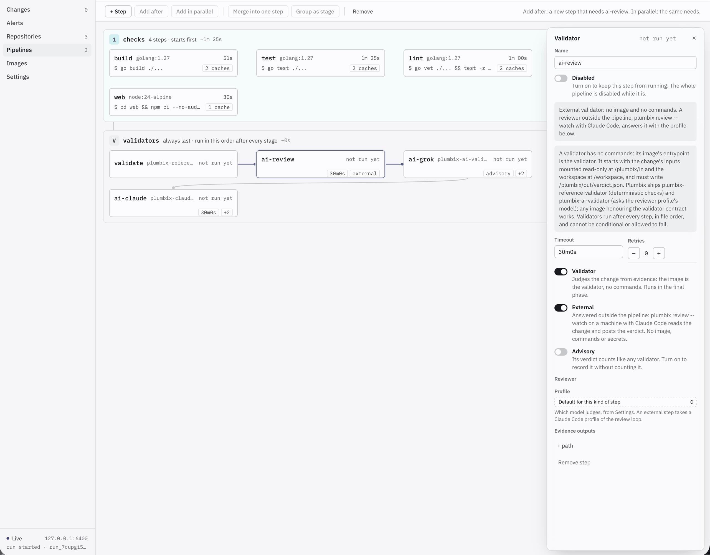
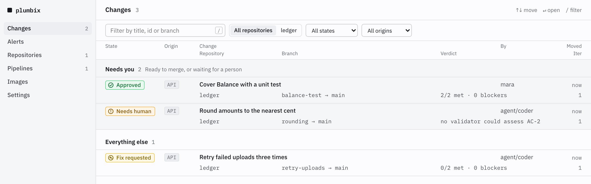
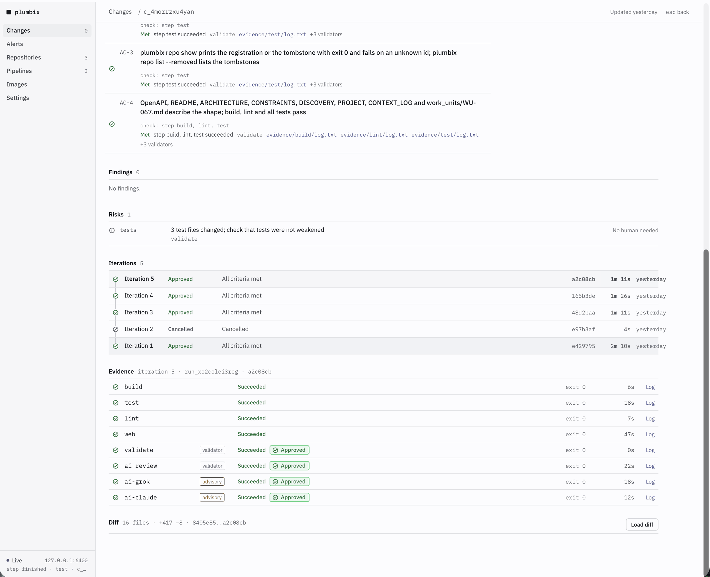
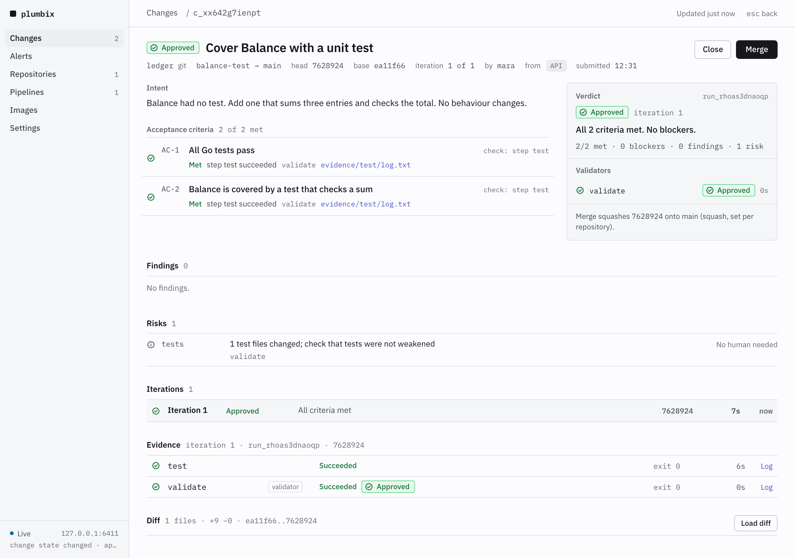
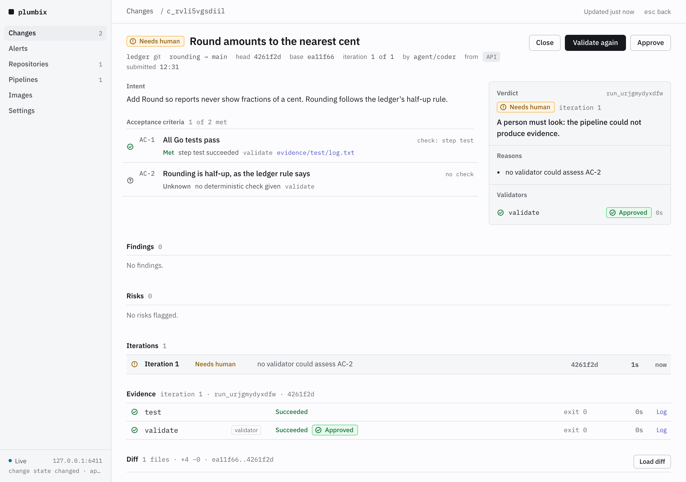
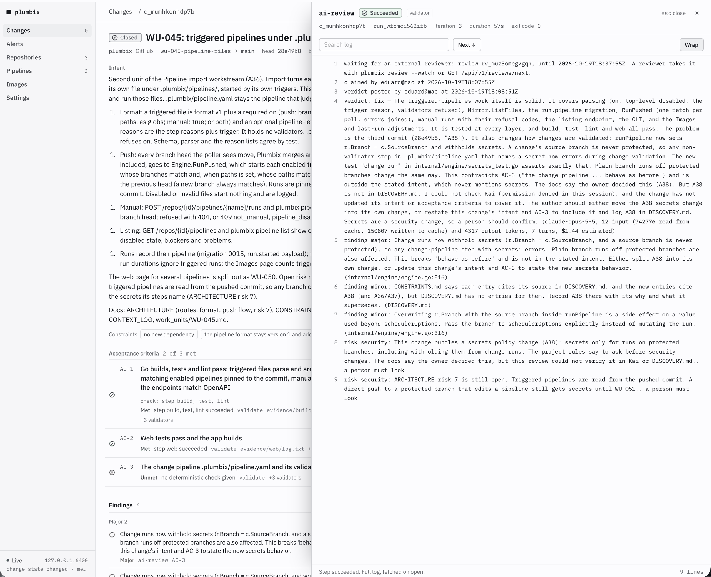

# Plumbix

Self-hosted, open-source pipelines and change review for the age of coding agents.

Plumbix is the governed path for changes that coding agents write. A change arrives with its intent and its acceptance criteria. Pipelines run in containers on your own machine, with as much parallelism as it has cores. Validators judge the change against its criteria from that evidence, a verdict decides what merges, and a person decides where a verdict is not enough. It works with plain git repositories on your machine or over SSH, with GitHub, and with Azure DevOps.

**Status** (2026-11-06): Milestone 1 complete: Plumbix validates and merges its own changes ([evidence](PROJECT.md#milestone-1-success-criteria)). Milestones 2 and 3 landed the governed path beside GitHub pull requests and its surfaces for an observer; Milestone 4, findings from a second repository, is under way, as is the front page and first run for an outside user. APIs may still change before the first tagged release. See [PROJECT.md](PROJECT.md) for the roadmap and [ARCHITECTURE.md](ARCHITECTURE.md) for the design.

## Why it exists

- Hosted tools charge for pipeline parallelism and limit how independent you can be.
- They are bloated with features most developers never use, behind interfaces that date from fifteen years ago.
- The pull request was designed for humans reviewing humans. Agent-written code needs the intent and the criteria fixed before the code, and a verdict tied to them.

## Quickstart

Five minutes on a machine with Go 1.27, Docker and git. Node 20 and npm are needed only for the web interface; a Go-only build works without it. Prebuilt binaries are planned.

```sh
git clone https://github.com/eduard-alloy/plumbix && cd plumbix
make build images        # bin/plumbix with the web interface embedded, and the shipped validator images
./bin/plumbix serve &    # listens on 127.0.0.1:6400 only; writes your API token to ~/.plumbix/api-token
```

Register a repository. A bare repository on your disk is enough to try it; you and your agents push branches to it.

```sh
git init --bare ~/git/myapp.git                              # or point at an existing bare repository
./bin/plumbix repo add --host git --url ~/git/myapp.git      # prints the registration, with its id
git clone ~/git/myapp.git ~/src/myapp && cd ~/src/myapp      # a working copy to push from
git checkout -B main                                         # whatever your default branch is called
```

Give the repository a pipeline: `.plumbix/pipeline.yaml`, committed on its main branch. A plain step runs a command in a container. A validator step is an image that judges the change instead; the reference validator ships with Plumbix and proves each criterion from the outcome of the steps it names.

```yaml
version: 1
steps:
  - name: test
    image: golang:1.27
    run: go test ./...
  - name: validate
    image: plumbix-reference-validator:dev
    validator: true
    needs: [test]
```

The same file in the browser's pipeline editor, here Plumbix's own: four checks in parallel, then the validators, one of them external and two advisory. The editor saves by editing your file's text, so a one-field change is a one-line diff.



```sh
git add .plumbix/pipeline.yaml && git commit -m "pipeline" && git push origin main
```

Make a change on a branch and push it, then submit the change with its intent and acceptance criteria.

```sh
git checkout -b my-branch
# make the change, then:
git add -A && git commit -m "the change" && git push origin my-branch
cat > change.json <<'EOF'
{"repo_id": "<id from plumbix repo list>", "source_branch": "my-branch", "target_branch": "main",
 "title": "What the change does", "intent": "Why, in a few sentences.",
 "acceptance_criteria": [{"text": "All Go tests pass", "check": {"steps": ["test"]}}]}
EOF
./bin/plumbix submit -f change.json          # prints the change, with its id
./bin/plumbix events --change <change-id>    # follow the run and the verdict, one JSON event per line
./bin/plumbix change runs <change-id>        # the runs so far: steps, criteria, findings
./bin/plumbix change merge <change-id>       # once approved: lands the validated tree on main
./bin/plumbix alert list                     # commits that reached main without a verdict
```

Then the browser: `./bin/plumbix login` prints a one-time link that signs you in at http://127.0.0.1:6400. Changes that need you come first, each with its verdict and evidence, and merge is one click. Settings holds the git host tokens, the AI reviewer profiles and the guidance validators follow. For an AI review, add a validator step with the `plumbix-ai-validator:dev` image and a reviewer profile, or an external step answered by `./bin/plumbix review --watch` wherever Claude Code is installed ([docs/reviews.md](docs/reviews.md)).

<picture>
  <source media="(prefers-color-scheme: dark)" srcset="docs/images/changes-dark.png">
  
</picture>

## Concepts

**Change.** What a client submits: a repository, a source and a target branch, the intent in words, and acceptance criteria. A pull request on GitHub becomes a change too, with its description as the intent and its checklist as the criteria.

**Acceptance criteria.** Written with the specification, before the code, by whoever owns the intent. A criterion bound to pipeline steps is proved by the deterministic validator from their outcomes; a criterion in words is judged by the AI review. A specification tool can post the criteria as a set, which a change then names by id; from then on the criteria are frozen ([docs/criteria.md](docs/criteria.md)).

**Validator.** A pipeline step whose image judges the change rather than running a command. It starts with the change's inputs and the workspace mounted and writes a verdict. Plumbix ships a deterministic reference validator, an AI validator that asks the model of a reviewer profile, and a validator that runs Claude Code; any image that honours the contract works. A second validator marked advisory judges every change beside the first, recorded but never counted ([docs/reviews.md](docs/reviews.md)).



**Verdict.** Approve, fix with findings, or reject, each reason tied to a criterion, with the model's token usage reported as the model gave it, never estimated. A fix verdict goes back to the client, whose agent pushes new commits, and Plumbix validates again, up to three rounds before a person is asked.

<picture>
  <source media="(prefers-color-scheme: dark)" srcset="docs/images/approved-dark.png">
  
</picture>

**Human approval.** A change nobody can approve mechanically waits for a person: an unmet criterion in words, a pipeline file edited, a verdict that asks for one, a server restart. A person approves it by name, in the browser, on the command line, or with an approving review on GitHub. In Plumbix's own pipeline an AI approval alone is never enough: the deterministic validator must approve too.

<picture>
  <source media="(prefers-color-scheme: dark)" srcset="docs/images/needs-human-dark.png">
  
</picture>

## Why not GitHub Actions plus an AI review bot?

| | Actions plus a review bot | Plumbix |
|---|---|---|
| What is judged | The diff, after the fact | The change against the intent and criteria written before the code |
| What a verdict says | Comments on lines | Approve, fix or reject, each reason tied to a criterion, with usage reported |
| Who judges | One model | A deterministic validator plus the reviewers you choose, side by side, one of them advisory |
| What merges | Whatever a person clicks | An approved change; a person is asked where the evidence is not enough; a commit that reaches the branch any other way raises an alert |
| Where it runs | Hosted runners, billed for parallelism | Containers on your machine, in parallel |
| With pull requests | Beside them | Beside them, with verdicts as check runs and the gate as a required check, or instead of them, with Plumbix merging ([docs/github.md](docs/github.md)) |

## From an agent session

Plumbix is also an MCP server. `claude mcp add plumbix -- plumbix mcp` gives a Claude Code session tools to register a repository, submit a change, wait for its verdict, read what the validators found and merge it, and to act as an external reviewer. A session never reviews a change it submitted, and approving a change stays a person's act ([docs/server.md](docs/server.md#agent-sessions)).

## Plumbix validates itself

Every change to this repository goes through Plumbix: four steps build, test and lint the Go code and the web interface in parallel, the reference validator judges the change, and an external review step waits for Claude Code on the maintainer's machine. Nothing lands on `main` without a verdict, and a commit that gets there any other way raises an alert. The proof is public: every commit in the [history of `main`](https://github.com/eduard-alloy/plumbix/commits/main) carries a green `plumbix/gate` check run that Plumbix posted on it, [this one](https://github.com/eduard-alloy/plumbix/runs/127842906364) for the commit that landed the front page you are reading. Below, the loop's log on one of Plumbix's own changes: the verdict was fix, with the reasons in words, three findings and two security risks that asked for a person. How that is set up, and how a change to Plumbix is submitted, is in [docs/server.md](docs/server.md#plumbix-validates-itself).



## Documentation

- [docs/server.md](docs/server.md): build, the API token, agent sessions, how Plumbix validates itself.
- [docs/repositories.md](docs/repositories.md): registering, importing and publishing repositories, images, the pipeline editor, caches, pause and remove.
- [docs/criteria.md](docs/criteria.md): acceptance criteria and criteria sets.
- [docs/reviews.md](docs/reviews.md): reviewer profiles, the external review loop, what happens when a review cannot be answered.
- [docs/github.md](docs/github.md): gating GitHub pull requests.
- [ARCHITECTURE.md](ARCHITECTURE.md): components, the pipeline file, the validator contract, every design decision. [PROJECT.md](PROJECT.md): purpose, features, roadmap. [CONSTRAINTS.md](CONSTRAINTS.md): what implementation taught.
- [contracts/](contracts/): the OpenAPI description, the event and verdict schemas, the check-run and launcher contracts.

## License

Apache 2.0. See [LICENSE](LICENSE).
